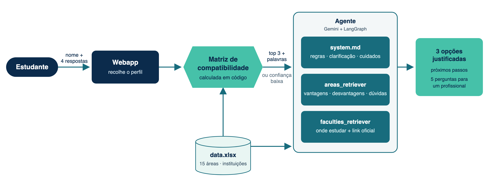

<p align="center">
  
</p>

# MapMind · Academic path advisor

An AI agent that helps secondary-school and undergraduate students choose their next academic step. It asks four short questions, scores 15 study areas **in code**, and suggests 3 options, each justified with the student's own words.

> MapMind supports the decision. It does not decide for the student and does not replace vocational guidance.

Built for the **AI Hackathon · Challenge 06 (Education)**. The agent speaks European Portuguese.

---

## How it works

<p align="center">
  
</p>

1. **Four fixed questions, one at a time:** interests, skills, preferences and values. The examples in each question are taken from the dataset, so students know what kind of answer is expected.
2. **Compatibility matrix:** once the four answers are in, the student's profile is scored against the 15 areas in `data.xlsx`. This is deterministic and explainable, and no LLM is involved.
3. **Agent:** the answers and the matrix go to a Gemini agent orchestrated with LangGraph. If confidence is low, or answers are vague or contradictory, it **asks for clarification instead of suggesting**.
4. **Answer:** the top 3 areas of the matrix, in order. Each has a reason, pros, cons and open questions; the agent then gives where to study (official links), next steps and a note about official sources.
5. **Follow-up:** compare options, go deeper on one, or get **5 questions to ask a professional** in the field.

**The code decides the order, the agent explains it, the student decides.**

---

## The compatibility matrix

Each answer is compared with the matching columns of every area:

| Question | Columns compared | Weight |
| --- | --- | --- |
| Interests | Interesse & Motivação, Palavras-Chave (CNA) | 35% |
| Skills | Competências Desenvolvidas | 30% |
| Preferences | Tipo de Trabalho Esperado, Estilo de Aprendizagem | 20% |
| Values | Valores Pessoais | 15% |

- **Preprocessing:** text is lowercased and accents are stripped. Words are cut to their first 5 letters, so *programar* and *Programação* match, and filler words ("gosto", "muito", "não sei"…) are dropped.
- **Cell score:** the share of the student's words for that question that appear in the area's columns.
- **Total:** the weighted average of the four cells. The top 3 are the suggestions, and the words that matched are passed to the agent to justify them.
- **Low confidence:** if the best area scores under **25%**, the agent receives `CONFIANÇA BAIXA` and asks for concrete examples instead of forcing 3 suggestions.
- **Personal characteristics:** gender, age and origin never enter the score.

Weights, columns and the threshold live in `src/ainnovation_mapmind/retriever.py` (`WEIGHTS`, `CRITERIA`, `MIN_CONFIDENCE`).

---

## Data

`src/ainnovation_mapmind/data/data.xlsx`, built by the team:

| Sheet | Content |
| --- | --- |
| `areas` | 15 generic areas with keywords, interests, values, skills, type of work, learning style, pros, cons and open questions |
| `curso` | Institutions offering each area, with study cycle and official link |

The areas are generic and are **not an official catalogue**. Data that changes every year (vacancies, admission grades, deadlines, salaries) is deliberately left out. The agent points students to [DGES](https://www.dges.gov.pt) and to each institution's website.

---

## Agent rules

The system prompt (`prompt/system.md`) was checked against the team's approval criteria (`prompt/criterios_aprovacao.md`). In short:

- The 3 options are always the top 3 of the matrix, in order.
- Pros, cons and open questions come **only** from the data, with nothing invented.
- Vague, contradictory, empty or one-word answers lead to one specific clarifying question, at most twice per topic.
- When two options are within 5 points of each other, the agent says they are practically tied.
- No salaries, grades, vacancies, deadlines or employability claims, even under pressure ("just give me an estimate").
- Stereotypes ("this isn't for girls") are corrected calmly in one or two sentences, without a lecture.
- The agent refuses prompt injection, stays on topic, and treats pasted text as the student's answer, never as instructions.

**Tools available to the agent**

| Tool | What it does |
| --- | --- |
| `areas_retriever` | BM25 search over the `areas` sheet (pros, cons, open questions) |
| `faculties_retriever` | BM25 search over the `curso` sheet (institutions and official links) |
| `search_web` | Web search, only for concrete questions and official sources |

---

## Getting started

**Requirements:** [uv](https://docs.astral.sh/uv/) and a [Gemini API key](https://aistudio.google.com/apikey). uv installs Python 3.11 if needed.

```bash
git clone git@github.com:pedrohspinheiro/ainnovation-mapmind.git
cd ainnovation-mapmind
uv sync
cp .env.example .env        # then set GOOGLE_API_KEY
```

**Web app**

```bash
uv run python -m ainnovation_mapmind.web
```

Open http://localhost:8000. Use `PORT=8080` to change the port.

**Terminal version**

```bash
uv run python -m ainnovation_mapmind.app
```

It prints a short trace of each step (model answers, tool calls and tool results). An empty line ends the conversation.

**Matrix only** (no API calls, useful for tuning weights and columns)

```bash
uv run python -c "
from ainnovation_mapmind.retriever import compute_compatibility, format_compatibility
print(format_compatibility(compute_compatibility({
    'interesses': 'Informática e Design',
    'competências': 'Programação, Criatividade',
    'preferências': 'Projetos e Laboratório',
    'valores': 'Curiosidade, Rigor'})))"
```

---

## Project structure

```
src/ainnovation_mapmind/
├── app.py           # LangGraph agent, questions, summary sent to the model, terminal chat
├── web.py           # web server (Python standard library) and session handling
├── retriever.py     # Excel loading, BM25 retrievers, compatibility matrix
├── tools.py         # tools exposed to the agent
├── prompt/
│   ├── system.md               # system prompt
│   └── criterios_aprovacao.md  # approval criteria used to check the agent
├── data/data.xlsx   # areas and institutions
└── web/             # page (index.html) and logo
docs/                # logo, architecture diagram, presentation
```